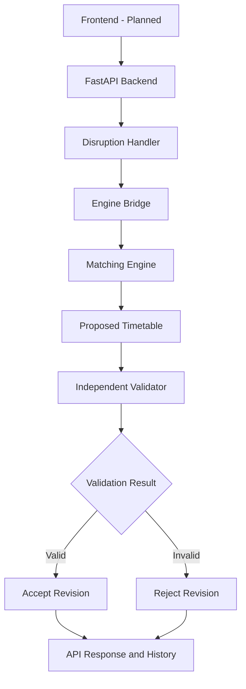

# 🚆 RailFlow
### Railway Disruption & Platform Conflict Simulator

**VORTEXA 3.0 · P-03 · Domain 6: Public Systems & Civic Technology**

RailFlow is a railway scheduling and disruption simulation system developed for the P-03 problem statement at VORTEXA 3.0, a 12-hour student hackathon.

It simulates a small fictional railway station, assigns trains to platforms under explicit constraints, detects scheduling conflicts, and provides a foundation for revising timetables when delays or platform closures occur.

The project combines a deterministic scheduling engine with a FastAPI backend. Its goal is to produce feasible timetable revisions, explain scheduling changes, and independently validate revised schedules before presenting them as valid.

> **Current status:** Matching Engine and backend implemented and tested locally. Frontend and remaining challenge requirements are in progress.

---

## 📌 Table of Contents

- [The Challenge](#-the-challenge)
- [Our Solution](#-our-solution)
- [Features](#-features)
- [Architecture](#-architecture)
- [Technology Stack](#-technology-stack)
- [Project Structure](#-project-structure)
- [Installation and Setup](#-installation-and-setup)
- [API Endpoints](#-api-endpoints)
- [Scheduling Logic](#-scheduling-logic)
- [Testing](#-testing)
- [Challenge Requirements](#-challenge-requirements)
- [Limitations](#-limitations)
- [Roadmap](#-roadmap)
- [Team](#-team)

---

## 🎯 The Challenge

Railway stations have a limited number of platforms. Each train occupies a platform from arrival until departure, and a minimum clearance gap may be required between consecutive occupancies.

A delay or platform closure can invalidate an existing timetable. Operators need to find a feasible revision quickly and ensure that no hidden conflicts remain.

The VORTEXA 3.0 P-03 challenge requires a simulator that can:

- Assign trains to platforms while respecting occupancy and clearance constraints.
- Detect overlapping or infeasible assignments and identify the affected trains and platforms.
- Simulate delays of specified lengths and platform closures over specified periods.
- Replan affected trains and record reasons for timetable changes.
- Independently validate every revised timetable.
- Use AI, where appropriate, to interpret free-text disruptions or explain scheduling trade-offs without allowing AI to decide platform assignments.

**Scope:** RailFlow uses fictional station data. It does not depend on live railway data.

---

## 💡 Our Solution

RailFlow separates constraint-based scheduling from disruption handling and API orchestration.

1. **Configure the station** — define platforms, trains, and the minimum clearance gap.
2. **Generate assignments** — calculate platform assignments using deterministic scheduling logic.
3. **Detect conflicts** — identify invalid inputs, overlapping occupancy, and infeasible schedules.
4. **Simulate disruptions** — apply train delays or platform closures.
5. **Replan** — search for valid platform assignments under the changed conditions.
6. **Validate independently** — check the proposed timetable using a separate validation process.
7. **Present the result** — expose assignments, conflicts, and validation results through the backend API.

AI-assisted interpretation of natural-language disruption reports is a planned extension. Scheduling decisions remain governed by explicit constraints.

---

## ✨ Features

### 🚉 Scheduling Engine

- Constraint-based platform assignment.
- Configurable minimum clearance gap.
- Required-platform constraints.
- Duplicate train ID detection.
- Invalid time and closure detection.
- Infeasible schedule detection.

### ⚠️ Disruption Handling

- Simulated train delays.
- Simulated platform closures.
- Platform reassignment through the scheduling engine.
- Disruption history.
- Validation of revised schedules through the integrated workflow.

### 🔌 Backend API

- FastAPI-based REST endpoints.
- Pydantic request validation.
- Interactive API documentation.
- Timetable retrieval.
- Delay and closure requests.
- Validation and disruption-history endpoints.

### 🛡️ Correctness First

AI is not responsible for deciding platform assignments. Assignments must satisfy explicit scheduling rules, and a timetable that fails validation must not be reported as valid.

---

## 🏗️ Architecture



### Components

| Component | Responsibility |
|---|---|
| Matching Engine | Computes platform assignments |
| Backend + AI | Handles API requests and disruption workflows |
| Engine Bridge | Connects the backend to the scheduling engine |
| Independent Validator | Checks timetable constraints separately from assignment generation |
| Frontend | Planned interface for timetable visualization and disruption simulation |

---

## 🛠️ Technology Stack

| Technology | Purpose |
|---|---|
| Python | Scheduling and backend logic |
| FastAPI | REST API |
| Pydantic | Request validation |
| Uvicorn | ASGI development server |
| Git and GitHub | Version control and collaboration |
| Visual Studio Code | Development environment |
| React + Vite | Planned frontend |

---

## 📁 Project Structure

```text
RailFlow/
├── Backend + AI/
│   ├── main.py
│   ├── engine_bridge.py
│   └── requirements.txt
│
├── Matching Engine/
│   ├── scheduler.py
│   ├── disruption_handler.py
│   ├── test_scheduler.py
│   └── test_disruption.py
│
└── README.md
```

The backend and Matching Engine are maintained in separate directories. The engine bridge connects the two components.

*Adjust the file tree if your actual repository differs.*

---

## 🚀 Installation and Setup

### Prerequisites

- Python 3.10 or newer recommended
- pip
- Git

### 1. Clone the repository

```bash
git clone <YOUR_GITHUB_REPOSITORY_URL>
cd RailFlow
```

Replace the placeholder with your GitHub repository URL.

### 2. Install dependencies

Open a terminal in `Backend + AI`:

```bash
python -m pip install fastapi "uvicorn[standard]" pydantic
```

If the project includes a complete `requirements.txt`, install from it instead:

```bash
python -m pip install -r requirements.txt
```

### 3. Start the backend

From the `Backend + AI` directory:

```bash
python -m uvicorn main:app --reload
```

The development server should start at:

```text
http://127.0.0.1:8000
```

### 4. Open the API documentation

Visit:

**http://127.0.0.1:8000/docs**

Use the interactive documentation to inspect endpoints, submit requests, and review responses.

Keep the server terminal open while testing.

### 5. Run the scheduler tests

Open a separate terminal:

```bash
cd "Matching Engine"
python test_scheduler.py
```

If the disruption test file is present:

```bash
python test_disruption.py
```

Run these commands from the directory containing the respective test files.

---

## 🔌 API Endpoints

The following endpoints are part of the current or planned integrated API. Confirm their presence in `/docs` before using them.

| Method | Endpoint | Purpose |
|---|---|---|
| `GET` | `/` | Backend status |
| `GET` | `/health` | Health check, if implemented |
| `GET` | `/timetable` | Retrieve timetable and conflicts |
| `POST` | `/schedule` | Calculate assignments, if implemented |
| `POST` | `/replan` | Trigger replanning, if implemented |
| `POST` | `/disruptions/delay` | Submit a train delay |
| `POST` | `/disruptions/closure` | Submit a platform closure |
| `POST` | `/validate` | Validate the timetable |
| `GET` | `/history` | Retrieve disruption history |

### Example: Train delay

`POST /disruptions/delay`

```json
{
  "train_id": "T101",
  "delay_minutes": 20
}
```

### Example: Platform closure

`POST /disruptions/closure`

```json
{
  "platform": "P2",
  "start": 600,
  "end": 640
}
```

Times are expressed as minutes after midnight. For example, `600` represents 10:00 AM.

The exact request and response schemas should match the implementation in `main.py`.

---

## 🧮 Scheduling Logic

The scheduler uses deterministic constraint-based logic to allocate platforms.

### Constraints

- Train IDs must be unique.
- Arrival and departure times must be valid.
- Departure must occur after arrival.
- Platform assignments must use configured platforms.
- Required-platform constraints must be respected.
- Platform occupancies must not overlap.
- The minimum clearance gap must be satisfied.
- Platform closures must be respected.
- Infeasible schedules must be reported explicitly.

### Scheduling outcomes

| Status | Meaning |
|---|---|
| `feasible` | A valid assignment was found |
| `infeasible` | No assignment satisfies the current constraints |
| `invalid` | The input or configuration is invalid |

The current engine assigns platforms for the supplied train times. Automatically shifting other trains' arrival and departure times to propagate or resolve delays is a separate scheduling capability that requires further development.

---

## 🧪 Testing

The scheduler test suite covers nine test groups:

- Basic scheduling.
- Platform conflicts and clearance gaps.
- Platform closure constraints.
- Required-platform constraints.
- Unknown required platforms.
- Invalid closures.
- Duplicate train IDs.
- Invalid train times.
- Infeasible schedules.

**Reported result:** All nine scheduler test groups passed locally.

The team has also reported passing initial backend API checks. These results establish progress, but further integrated testing is needed to demonstrate the complete disruption-replanning workflow.

---

## 📋 Challenge Requirements

| Official P-03 requirement | Project status |
|---|---|
| Assign trains to platforms | Implemented |
| Respect minimum clearance gaps | Implemented in scheduler |
| Detect conflicts and infeasible assignments | Basic implementation and tests completed |
| Support train delays | Backend workflow implemented; full recovery needs verification |
| Support platform closures | Backend workflow implemented; full recovery needs verification |
| Replan affected trains | Platform reassignment exists; comprehensive disruption recovery remains in progress |
| Record reasons for timetable changes | Further implementation required |
| Independently validate every revised timetable | Integration present; independence and full coverage require verification |
| AI interpretation of free-text disruptions | Planned |
| AI explanation of revision trade-offs | Planned |
| Interactive frontend | Planned |

---

## ⚠️ Limitations

RailFlow is a prototype for a fictional railway station.

- The frontend is still under development.
- Timetable and history data may be stored in memory and reset when the server restarts.
- The current scheduler works with fixed arrival and departure times.
- Global optimization and minimum-change timetable revision are not guaranteed.
- Detailed reasons for each timetable change require further work.
- Natural-language AI disruption interpretation is not yet implemented.
- End-to-end testing of the complete disruption workflow remains necessary.
- No live railway data or operational railway infrastructure is used.

---

## 🗺️ Roadmap

### Phase 1 — Scheduling Engine

- [x] Basic platform assignment
- [x] Conflict detection
- [x] Clearance-gap enforcement
- [x] Platform-closure constraints
- [x] Required-platform constraints
- [x] Nine scheduler test groups

### Phase 2 — Backend

- [x] FastAPI backend
- [x] Engine bridge
- [x] Delay and closure endpoints
- [x] Initial validation workflow
- [x] Disruption history

### Phase 3 — Frontend

- [ ] Interactive timetable dashboard
- [ ] Platform occupancy timeline
- [ ] Delay and closure controls
- [ ] Original-versus-revised timetable comparison
- [ ] Conflict and validation indicators
- [ ] Clear infeasibility and error messages

### Phase 4 — Advanced Replanning

- [ ] Track affected trains
- [ ] Record reasons for each assignment change
- [ ] Explore delay propagation
- [ ] Minimize unnecessary timetable changes
- [ ] Expand independent validation and regression testing

### Phase 5 — AI Integration

- [ ] Interpret free-text disruption reports
- [ ] Convert AI output into structured disruption proposals
- [ ] Require validation before applying proposed changes
- [ ] Explain trade-offs between feasible revisions
- [ ] Provide a local fallback for the core demonstration

---

## 👥 Team

RailFlow is developed collaboratively across three workstreams.

| Workstream | Responsibility |
|---|---|
| Matching Engine | Scheduling algorithm and tests |
| Backend + AI | API integration, disruptions, and validation |
| Frontend | Timetable visualization and user interaction |

Add your team members' names and GitHub profiles here.

---

## 📄 Disclaimer

RailFlow is an educational simulation developed for the VORTEXA 3.0 P-03 challenge. It is not designed or certified for operational railway control.

---

**VORTEXA 3.0 · P-03 — RailFlow**

*Simulate disruptions. Replan platform assignments. Validate every revision.*
