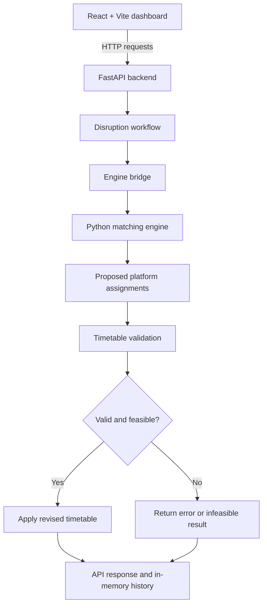

# 🚆 RailFlow

### Railway Disruption & Platform Conflict Simulator

**VORTEXA 3.0 · P-03 · Domain 6: Public Systems & Civic Technology**

RailFlow is an educational railway operations simulator that demonstrates how train-platform assignments can be generated, checked, and revised when disruptions occur. It combines a React dashboard, a FastAPI backend, and a deterministic constraint-based matching engine.

The prototype uses an illustrative timetable and a simulated station-yard view. It is designed for demonstrations, experimentation, and learning—not for real railway operations.

> **Project status:** The React/Vite frontend, FastAPI backend, and Python matching engine are present in the repository. Features and limitations below describe the prototype as implemented; not every advanced disruption-management requirement is complete.

---

## Contents

- [Overview](#-overview)
- [Features](#-features)
- [Architecture](#-architecture)
- [Technology Stack](#-technology-stack)
- [Repository Structure](#-repository-structure)
- [Requirements](#-requirements)
- [Getting Started](#-getting-started)
- [API Reference](#-api-reference)
- [Scheduling Model](#-scheduling-model)
- [Testing](#-testing)
- [Security Notes](#-security-notes)
- [Known Limitations](#-known-limitations)
- [Roadmap](#-roadmap)
- [Contributing](#-contributing)
- [License](#-license)
- [Disclaimer](#-disclaimer)

---

## 🎯 Overview

Railway stations have a finite number of platforms. Each train occupies its assigned platform between its arrival and departure, and a clearance interval may be required before another train can use the same platform. Delays and platform closures can make a previously valid allocation infeasible.

RailFlow models this problem with explicit constraints. The scheduling engine proposes platform assignments; the backend validates the resulting timetable before accepting a revision. The interface provides a dashboard for inspecting the simulation and submitting supported disruption actions.

### Design principles

- **Constraint-based decisions:** platform assignments are computed by deterministic scheduling logic, not by a generative AI model.
- **Validation before acceptance:** revised schedules are checked for conflicts and invalid assignments.
- **Explicit failure states:** invalid input and infeasible schedules should be reported rather than silently treated as successful.
- **Simulation-first:** the included data is illustrative and does not represent a verified live railway timetable.

---

## ✨ Features

### 🚉 Matching engine

- Assigns trains to available platforms.
- Enforces a configurable minimum clearance gap.
- Supports required-platform constraints.
- Accounts for platform closures during train occupancy.
- Detects duplicate train IDs and invalid times.
- Reports when a valid assignment cannot be found.
- Can prefer a train's current or requested platform when it remains feasible.

### ⚠️ Disruption simulation

The backend includes workflows for:
- Applying a delay to a train.
- Closing a platform over a specified time interval.
- Re-running platform assignment after a supported disruption.
- Recording disruption history in server memory.
- Returning timetable, conflict, assignment, and validation information.

The engine primarily reallocates platforms for the supplied arrival and departure times. It does **not** yet provide a complete railway-grade delay-propagation system that automatically shifts the times of connected trains.

### 🖥️ Web dashboard

- React and Vite frontend.
- RailFlow dashboard with a tracking/schematic panel.
- Disruption controls for supported scenarios.
- Login screen for demo navigation.
- Responsive CSS work for desktop and smaller screens.

The login flow is currently a **frontend demonstration**, not production authentication. See [Security Notes](#-security-notes).

### 🔌 Backend API

- FastAPI REST service.
- Pydantic request validation.
- Interactive OpenAPI/Swagger documentation.
- Timetable and health endpoints.
- Disruption submission, replanning, validation, and history endpoints.

---

## 🏗️ Architecture



### Components

| Component | Responsibility |
|---|---|
| `Frontend/` | React user interface, dashboard, tracking schematic, and disruption controls |
| `Backend + AI/main.py` | FastAPI application, demo data, request handling, disruption workflow, and validation |
| `Backend + AI/engine_bridge.py` | Adapter between the API and matching engine |
| `Matching Engine/scheduler.py` | Deterministic platform assignment algorithm |
| `Matching Engine/conflict_detector.py` | Conflict-detection logic |
| `Matching Engine/disruption_handler.py` | Disruption-related scheduling utilities |
| `Matching Engine/validator.py` | Validation utilities |
| `Matching Engine/test_scheduler.py` | Scheduler tests |
| `Matching Engine/test_disruption.py` | Disruption-related tests |

---

## 🧰 Technology Stack

| Technology | Use |
|---|---|
| Python | Scheduling and backend logic |
| FastAPI | HTTP API |
| Pydantic | Request-schema validation |
| Uvicorn | ASGI development server |
| React | Frontend UI |
| Vite | Frontend development server and build tool |
| JavaScript / JSX | Frontend behavior |
| CSS | Styling and responsive layout |
| Git and GitHub | Version control and collaboration |

---

## 📁 Repository Structure

```text
RailFlow/
├── Backend + AI/
│   ├── main.py
│   └── engine_bridge.py
├── Frontend/
│   ├── index.html
│   ├── package.json
│   ├── vite.config.js
│   ├── public/
│   └── src/
│       ├── App.jsx
│       ├── App.css
│       ├── AuthGate.jsx
│       ├── Login.jsx
│       ├── login.css
│       ├── DisruptionConsole.jsx
│       ├── DisruptionConsole.css
│       ├── TrackingPanel.jsx
│       ├── TrackingPanel.css
│       ├── index.css
│       └── main.jsx
├── Matching Engine/
│   ├── scheduler.py
│   ├── conflict_detector.py
│   ├── disruption_handler.py
│   ├── validator.py
│   ├── test_scheduler.py
│   └── test_disruption.py
├── LICENSE
└── README.md
```

---

## ⚙️ Requirements

Install the following before running the project:

- **Python 3.10+** recommended.
- **Node.js** compatible with the Vite version in `Frontend/package.json` (use a current supported LTS release).
- npm, included with Node.js.
- Git (optional if you downloaded the source ZIP).

Commands below use PowerShell on Windows, but equivalent commands work in other shells with small path adjustments.

---

## 🚀 Getting Started

### 1. Clone the repository

Replace the placeholder URL with the repository URL:

```powershell
git clone <YOUR_GITHUB_REPOSITORY_URL>
cd RailFlow
```

If you downloaded a ZIP instead, extract it and open the extracted `RailFlow` folder in VS Code.

### 2. Start the backend

Open a terminal in the repository root, then run:

```powershell
cd "Backend + AI"
python -m pip install fastapi "uvicorn[standard]" pydantic
python -m uvicorn main:app --reload
```

The API should be available at:

- API root: `http://127.0.0.1:8000/`
- Health check: `http://127.0.0.1:8000/health`
- Interactive API docs: `http://127.0.0.1:8000/docs`
- OpenAPI schema: `http://127.0.0.1:8000/openapi.json`

Keep this terminal running.

> **Important:** Start Uvicorn from `Backend + AI/` so the local `engine_bridge.py` import resolves as expected. If your team adds a `requirements.txt`, prefer installing dependencies with `python -m pip install -r requirements.txt`.

### 3. Start the frontend

Open a **second terminal** at the repository root:

```powershell
cd Frontend
npm install
npm run dev
```

Vite will print the local URL, normally:

```text
http://localhost:5173
```

Open the URL shown in your terminal. Keep the frontend and backend terminals running together.

### 4. Run the scheduler tests

Open another terminal from the repository root:

```powershell
cd "Matching Engine"
python test_scheduler.py
python test_disruption.py
```

Run each test file that is present in your checkout. A test file may need to be run from its own directory because the project uses local Python module imports.

### 5. Build the frontend

From `Frontend/`:

```powershell
npm run build
```

Vite writes the production build to `Frontend/dist/`. To preview that build locally:

```powershell
npm run preview
```

The preview command serves the frontend only; the API still needs to be running and reachable.

---

## 🔌 API Reference

The running API's `/docs` page is the authoritative reference for the request schemas and responses in your current checkout.

| Method | Endpoint | Purpose |
|---|---|---|
| `GET` | `/` | Returns backend status and the docs path |
| `GET` | `/health` | Basic health check |
| `GET` | `/timetable` | Returns demo trains, platforms, closures, conflicts, and validation status |
| `POST` | `/replan` | Attempts to reassign platforms and validate the timetable |
| `POST` | `/disruptions/delay` | Applies a delay to a train and attempts to replan |
| `POST` | `/disruptions/closure` | Closes a platform for a time interval and attempts to replan |
| `POST` | `/validate` | Validates the current timetable |
| `GET` | `/history` | Returns disruption history recorded in memory |

The backend code may include additional disruption models or endpoints in development. Check `/docs` for the endpoints actually exposed by the version you are running.

### Example: health check

```http
GET http://127.0.0.1:8000/health
```

Expected shape:

```json
{
  "status": "ok"
}
```

### Example: apply a train delay

`POST /disruptions/delay`

```json
{
  "train_id": "12025",
  "delay_minutes": 10
}
```

The `train_id` must exist in the current demo timetable. Delay values must satisfy the request model's validation limits, and the resulting departure must not exceed the simulated day boundary.

### Example: close a platform

`POST /disruptions/closure`

```json
{
  "platform": "P2",
  "start": 600,
  "end": 640
}
```

Times are integer **minutes after midnight**: `600` means 10:00 AM and `640` means 10:40 AM. The end must be later than the start, and the platform must be configured.

### Scheduling response states

| Status | Meaning |
|---|---|
| `feasible` | A valid platform assignment was found |
| `infeasible` | No assignment satisfies the active constraints |
| `invalid` | The scheduler input or configuration is invalid |

An HTTP error can indicate that a requested disruption could not be applied without producing an infeasible timetable. Inspect the response body and `/docs` to understand the exact behavior of the running version.

---

## 🧮 Scheduling Model

The scheduler treats each train's arrival and departure as a platform-occupancy interval.

### Constraints

1. Train IDs must be unique.
2. Arrival must be non-negative.
3. Departure must be later than arrival and no later than minute `1440`.
4. The platform must be one of the configured platforms.
5. Required-platform constraints must be respected.
6. Two trains must not occupy the same platform at overlapping times.
7. The configured clearance gap must be satisfied between successive occupancies.
8. A train must not occupy a platform during a closure that overlaps its interval.

### Clearance rule

For two trains assigned to the same platform, the schedule is considered non-conflicting when one train's departure plus the required gap is no later than the other's arrival.

The current scheduler uses a search-based assignment strategy and selects a train with the fewest available platform choices first. This is a constraint-solving heuristic, not a guarantee of globally optimal or minimum-change schedules.

### What the scheduler does not guarantee

- A globally optimal assignment.
- The fewest possible platform changes.
- Automatic propagation of delays across connected trains.
- A feasible solution when all constraints cannot be satisfied.

When a schedule is infeasible, the correct outcome is to report that no assignment was found under the current constraints—not to imply that the disruption has been resolved.

---

## 🧪 Testing

The repository includes Python test files for the scheduler and disruption-related behavior.

Run:

```powershell
cd "Matching Engine"
python test_scheduler.py
python test_disruption.py
```

Use the test output from your own current checkout as the source of truth. Before a release or demonstration, also test the complete workflow through the API and frontend:

- Load the timetable.
- Apply a delay to a known train.
- Apply a platform closure.
- Check the returned assignments and validation status.
- Submit a disruption that should be infeasible and verify that it is rejected cleanly.
- Restart the backend and confirm which data resets.

---

## 🔐 Security Notes

RailFlow is currently a local development/demo prototype.

- The login interface is **not a secure authentication system** if credentials are checked only in frontend code.
- Never put passwords, API keys, or other secrets in React source files or public environment variables.
- The timetable, disruption history, and closures are held in server memory in the current backend implementation and may reset on restart.
- Before exposing the backend to the public internet, add real server-side authentication and authorization, review CORS settings, validate all inputs, configure HTTPS, and add suitable rate limiting and logging.
- Do not use this prototype to control real trains, railway infrastructure, or safety-critical decisions.

---

## ⚠️ Known Limitations

- The timetable is illustrative demo data, not an official or live railway timetable.
- The station-yard tracking view is a simulation/schematic, not verified GPS tracking or an engineering map.
- Backend state and disruption history are in memory and are not persistent.
- The current scheduling model primarily reallocates platforms for supplied train times; full delay propagation is not implemented.
- Minimum-change optimization and global optimality are not guaranteed.
- Detailed explanations for every timetable change and AI-based natural-language disruption interpretation are not complete.
- End-to-end testing should be expanded before treating the prototype as release-ready.
- The demo login should not be considered production security.

---

## 🗺️ Roadmap

### Core scheduling
- [x] Constraint-based platform assignment
- [x] Clearance-gap handling
- [x] Platform closure constraints
- [x] Required-platform constraints
- [x] Invalid input and infeasible-state reporting
- [ ] Broader edge-case and regression coverage

### Disruption management
- [x] Delay request workflow
- [x] Platform closure workflow
- [x] Replanning attempt after supported disruptions
- [x] Basic validation and in-memory history
- [ ] Explain each platform change with a recorded reason
- [ ] Delay propagation across connected services
- [ ] Minimum-change optimization
- [ ] Persistent storage and audit trail

### Frontend and deployment
- [x] React/Vite dashboard
- [x] Disruption controls and tracking schematic
- [ ] Full accessibility and mobile-device testing
- [ ] Configurable API base URL for deployment
- [ ] Production-grade authentication
- [ ] Deployment and monitoring documentation
- [ ] PWA/offline capabilities, if required

### AI-assisted explanations
- [ ] Parse free-text disruption descriptions into structured proposals
- [ ] Explain trade-offs between feasible schedules
- [ ] Keep all proposed assignments subject to deterministic constraints and validation
- [ ] Provide a clear fallback when AI services are unavailable

---

## 🤝 Contributing

Contributions, bug reports, and suggestions are welcome.

1. Fork the repository or create a feature branch.
2. Keep changes focused and describe the problem they solve.
3. Run the relevant Python tests and build the frontend.
4. Include steps to reproduce bugs and screenshots for UI changes where useful.
5. Open a pull request with a concise summary and test results.

For a team workflow, avoid committing generated folders such as `node_modules/`, Python `__pycache__/`, local secrets, or virtual environments.

---

## 👥 Team

RailFlow was developed collaboratively for the VORTEXA 3.0 P-03 challenge.

Add team members and their profile links here:

- **Project lead:** [Name](https://github.com/your-username)
- **Matching engine:** [Name](https://github.com/your-username)
- **Frontend / backend:** [Name](https://github.com/your-username)

Replace these placeholders with the team's actual names and GitHub profiles before publishing.

---

## 📄 License

RailFlow is released under the [MIT License](LICENSE).

---

## ⚖️ Disclaimer

RailFlow is an educational simulation and hackathon prototype. It is provided “as is,” without warranties or guarantees. It is not certified or intended for operational railway control, live train dispatching, or other safety-critical use.

---

**RailFlow · VORTEXA 3.0 · P-03**

*Simulate disruptions. Replan platform assignments. Validate every revision.*
